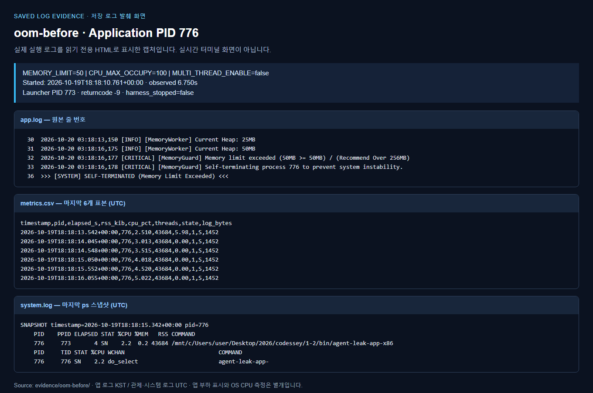
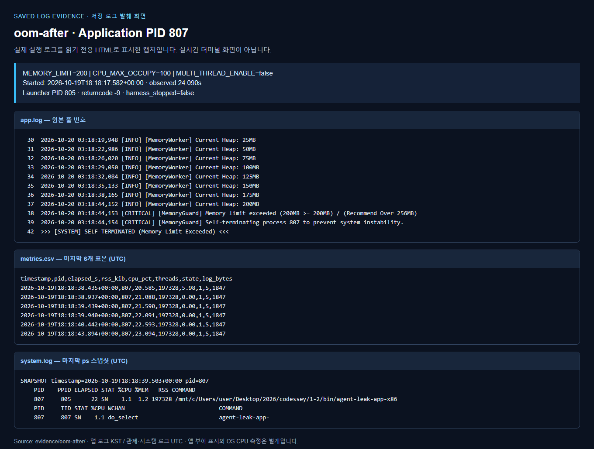
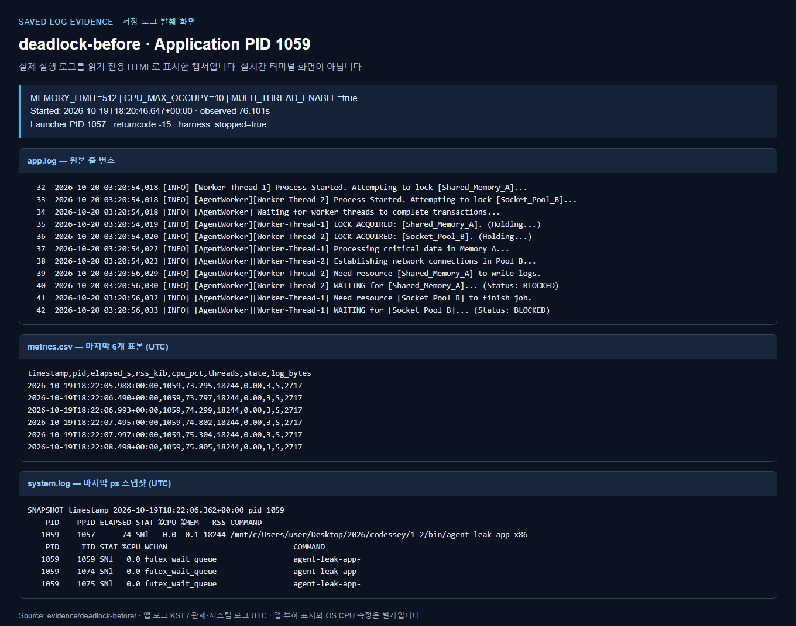
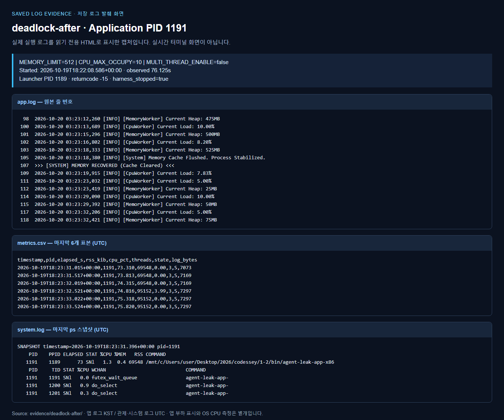
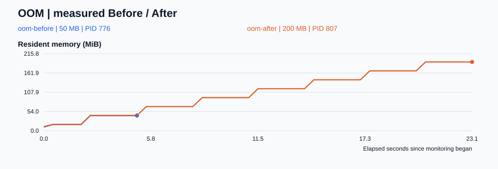
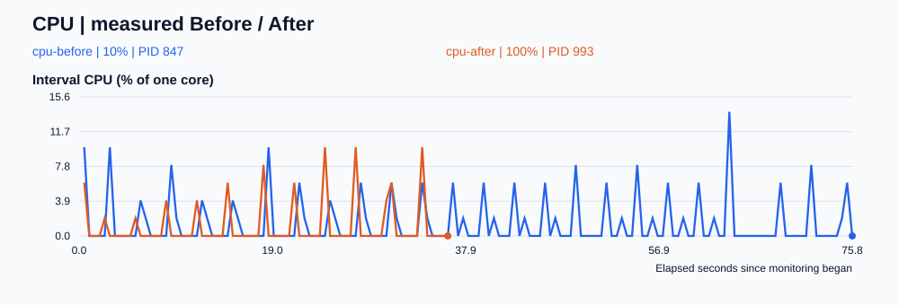
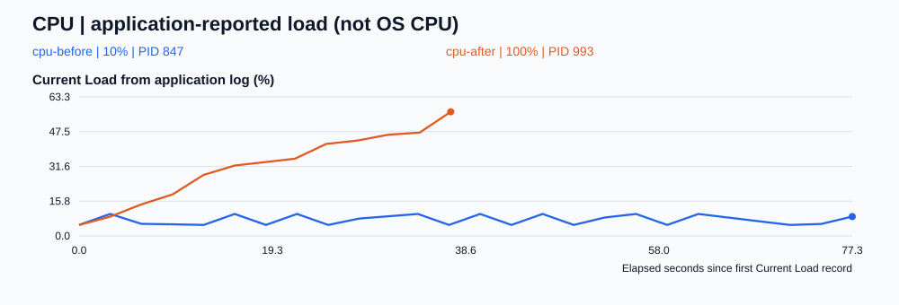
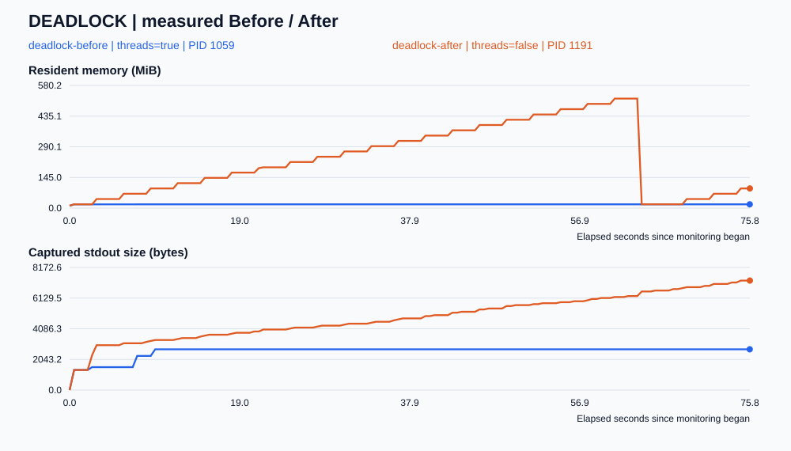
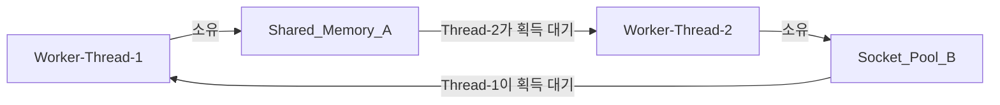
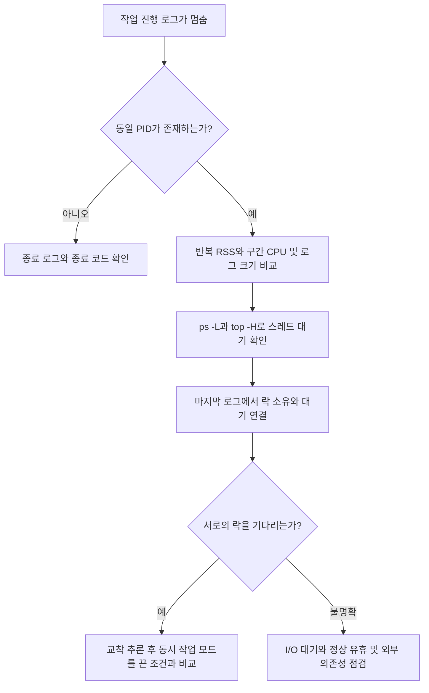

# Linux 장애 분석 실습: OOM · CPU Spike · Deadlock

제공된 `agent-app-leak.zip`의 Linux 바이너리를 실행하고 환경변수만 조정해 장애를 비교한다. 필수 평가 항목 1~4를 다루며, 보너스인 스케줄링 알고리즘 추론은 수행하지 않는다. 바이너리 디컴파일·소스 수정 없이 로그와 Linux 관제 도구로 분석했다.

## 실험 핵심 요약

**실험 장소:** 현재 Windows PC의 **WSL2 Ubuntu 22.04**에서 일반 사용자로 Linux x86 바이너리를 실행했다. 2026년 10월 20일, 장애 3종을 설정 변경 전후로 총 6회 비교했다. 원본 로그는 [evidence 폴더](evidence/), 환경 기록은 [environment.txt](evidence/environment.txt)에 있다.

| 장애 | 바꾼 환경변수 | 실제 실행 순서 | 확인한 결과 |
|---|---|---|---|
| OOM | MEMORY_LIMIT | 50 → 200MB | 종료 확인까지 약 6.75 → 24.09초로 늘어남 |
| CPU | CPU_MAX_OCCUPY | 10 → 100 | 10은 관측 창까지 생존, 100은 Watchdog 종료 |
| Deadlock | MULTI_THREAD_ENABLE | true → false | 서로 락을 기다리는 상태에서 작업이 진행되는 상태로 바뀜 |

**CPU의 완화 방향은 100 → 10**이다. 이 값은 앱의 부하 동작을 조절하며 OS의 CPU 할당률을 지정하는 값이 아니다. 앱 부하 56.5%에서 Watchdog 종료가 기록됐지만, 같은 실행의 외부 CPU 최고치는 약 9.97%였다.

| 용어 | 이번 실습에서의 의미 |
|---|---|
| 메모리 누수 | 필요 없어진 데이터가 계속 남아 메모리가 누적되는 문제. 실제 누수 객체는 추가 분석 필요 |
| RSS | 프로세스 메모리 중 현재 RAM에 상주하는 크기. 18,244KiB는 약 17.8MiB |
| Watchdog | 정해진 조건을 감시하고 이상 시 보호 조치를 수행하는 기능. 이번에는 SIGTERM으로 종료 요청 |

**데드락 예시:** 스레드 1은 A를 잡고 B를 기다리고, 스레드 2는 B를 잡고 A를 기다렸다. 실습에서는 멈춘 프로세스를 종료한 뒤 `MULTI_THREAD_ENABLE=false`로 새로 실행해 교착을 유발하는 동시 작업 모드를 껐다. 코드 수준의 예방은 모든 스레드의 락 획득 순서를 **A → B로 통일**하는 것이다.

**실제로 쓴 명령어와 옵션:** 아래 `1059`는 당시 데드락 실행의 앱 PID다. 새 실험에서는 현재 PID로 바꿔야 한다.

```bash
# -p: PID 선택, -o: 출력 열 선택
ps -p 1059 -o pid,ppid,etimes,stat,pcpu,pmem,rss,args
# -L: 스레드별 표시, wchan: 대기 지점
ps -L -p 1059 -o pid,tid,stat,pcpu,wchan:32,comm
# -b: 배치 출력, -H: 스레드별 표시, -n 1: 한 번 출력
top -b -H -n 1 -p 1059
```

## 제출물과 읽는 순서

**처음 이해하거나 발표를 준비한다면:** [쉬운 설명과 발표 가이드](docs/explanation-guide.md)를 먼저 읽으세요. [브라우저용 문서](docs/explanation-guide.html)는 비유·그림·실측 비교·발표 문장·예상 질문을 한 흐름으로 볼 수 있도록 구성했습니다. HTML 파일을 내려받아 브라우저에서 열면 됩니다.

**평가 질문에 답할 때는:** [평가 문항별 설명과 답변](docs/evaluation-answers.md) 또는 [브라우저용 답변 문서](docs/evaluation-answers.html)를 보세요. 보너스를 제외한 20개 문항을 질문·평가 의도·답변 예시·근거 순서로 정리했습니다.

1. 아래 실제 측정 그래프와 비교표로 결과를 확인한다.
2. [OOM 보고서](reports/01-oom.md), [CPU 보고서](reports/02-cpu.md), [Deadlock 보고서](reports/03-deadlock.md)를 읽는다. 모두 GitHub Issue의 **현상 → 증거 → 원인 → 조치·검증** 구조다.
3. [실험 원본](evidence/)에서 `app.log`, `metrics.csv`, `system.log`, `result.json`을 확인한다. 보고서 파일은 GitHub Issue 본문으로도 사용할 수 있다. 원격 Issue 등록은 별도이며 이 저장소에는 Markdown 보고서를 제공한다.
4. 아래 설명 자료로 사용한 도구와 OS 원리, 운영 환경 개선 방안을 설명한다.

### 발표할 때 짚을 핵심

- **OOM:** “실제 작업 PID의 RSS와 앱 Heap가 계속 늘었고 MemoryGuard 로그로 종료 원인을 확인했습니다. 50 → 200MB에서 관측 생존 시간이 약 6.75 → 24.09초로 늘었지만 누적 자체는 계속됐습니다.”
- **CPU:** “앱 부하가 56.5%에 도달한 뒤 Watchdog가 SIGTERM을 보냈습니다. 10% 설정에서는 관측 창까지 생존했습니다. 단, 외부 CPU 점유율은 앱 부하 수치와 달라 실제 CPU 50% 초과를 확인했다고 말할 수는 없습니다.”
- **Deadlock:** “PID가 살아 있어도 정상은 아닙니다. 두 스레드가 서로의 락을 기다리는 마지막 로그와 자원·로그 정체를 함께 확인했고, false 설정에서는 작업이 다시 진행됐습니다.”
- **도구 선택:** “ps로 실제 PID와 스레드를 확인하고, /proc 반복 표본으로 구간 CPU·RSS를 추적한 뒤 마지막 락 로그와 연결했습니다.”
- **운영 개선:** “한도 변경은 임시 조치입니다. 증가율 경보와 진행률 감시를 추가하고, 무제한 데이터 보관·busy loop·역순 락 획득을 코드에서 제거하겠습니다.”

## 실제 측정 시각자료

상세 수치는 [실험 비교표](reports/comparison.md)에 있다. 그래프는 `scripts/build_reports.py`가 원본 CSV에서 생성한다. 선의 끝은 마지막 관측값이며, 종료 원인은 앱 로그 및 `result.json`과 함께 판독한다.

### 실제 로그 캡처

저장된 원본 로그를 HTML로 표시한 뒤 브라우저에서 캡처한 PNG다. 실시간 터미널 화면과 구분했으며, 각 화면에 앱 PID·환경변수·시각·원본 줄 번호·관제 CSV·마지막 `ps` 출력을 담았다. 이미지를 클릭하면 원본 크기로 볼 수 있다. 원본 로그는 `evidence/`에 그대로 보관했다.

<details>
<summary>OOM 로그: 50MB / 200MB 한도 도달과 강제 종료</summary>




</details>

<details>
<summary>CPU 로그: 낮은 설정의 생존 / 높은 설정의 Watchdog 종료</summary>


</details>

<details>
<summary>Deadlock 로그: 순환 락 대기 / 동시 작업 모드 비활성화 후 진행</summary>




</details>

캡처용 HTML은 `python scripts/build_log_captures.py`로 다시 만들고, `python scripts/build_log_captures.py --capture`로 PNG까지 생성할 수 있다. Chrome 또는 Chromium이 필요하며, 캡처를 갱신한 뒤 `python scripts/build_reports.py`와 `python scripts/check_results.py`로 보고서·링크를 확인한다.

### OOM: 한도를 높이면 종료가 늦어지는가?



RSS는 Linux가 관측한 실제 상주 메모리다. 앱의 `Current Heap` 및 `MEMORY_LIMIT`와는 측정 범위가 달라 숫자가 같지 않다. 계단 형태로 일정량씩 증가하는 것도 시간에 비례한 누적 증가 패턴에 해당한다. 한도 상향은 누수를 고치지 않으며 더 큰 메모리를 쓸 때까지 종료를 늦추는 임시 조치다.

### CPU: 임계치와 종료 동작이 달라지는가?



CPU 그래프는 **한 코어를 100%로 보는 외부 측정값**이다. 앱 Watchdog의 내부 계산값·검사 주기와 다를 수 있으므로 선이 임계치를 넘었다는 사실만으로 종료 원인을 단정하지 않는다. 반드시 `WATCHDOG` 및 `SIGTERM` 로그와 비교한다. 임계치 상향은 CPU 사용을 줄이는 설정이 아니다.



두 그래프는 별개의 지표다. 이 제공 바이너리의 `Current Load` 상승과 CPU 임계치 위반 로그를 관측했지만, 이를 동일한 비율의 실제 OS CPU 점유로 해석하지 않는다. 평가 설명에서도 “앱이 보고한 부하”와 “외부에서 측정한 점유율”을 구분해야 한다. CPU 실험은 10 → 100%로 변화시킨 실험 순서이며, 개선 방향은 100 → 10%로 낮추는 것이다.

### Deadlock: 살아 있는 PID와 멈춘 작업 구별





상호 배제는 한 락을 동시에 한 스레드만 소유한다는 뜻이다. A가 A 락을 쥔 채 B 락을, B가 B 락을 쥔 채 A 락을 기다리면 순환 대기가 생긴다. 점유 대기와 비선점까지 함께 성립하면 두 스레드 모두 진행하지 못한다. 이 그림의 실제 대응 관계는 [보고서의 마지막 락 로그](reports/03-deadlock.md)로 확인한다. 프로세스 상태 `S`나 `futex` 대기만으로 교착을 확정할 수는 없다.

## 평가 항목 1: 증거와 비교

| 평가 요소 | 제출 위치 / 확인 기준 |
|---|---|
| OOM 증가 및 강제 종료 | [OOM 보고서](reports/01-oom.md), `evidence/oom-*/metrics.csv`, MemoryGuard 로그 |
| MEMORY_LIMIT 전후 | OOM 보고서의 50 → 200MB 비교, 다른 설정 고정 |
| CPU 상승 및 정책 종료 | [CPU 보고서](reports/02-cpu.md), CPU 구간 측정값과 Watchdog 로그 |
| CPU_MAX_OCCUPY 전후 | CPU 보고서의 10 → 100% 비교, 다른 설정 고정 |
| PID 유지·자원 정체·로그 중단 | [Deadlock 보고서](reports/03-deadlock.md), 반복 `ps -L`/`top -H` 출력과 CSV |
| MULTI_THREAD_ENABLE 전후 | Deadlock 보고서의 true → false 비교, 다른 설정 고정 |
| 보고서 3건 형식 | 각 파일의 Description / Evidence / Root Cause / Workaround |
| PID·타임스탬프·핵심 메시지 | 각 `system.log`, `app.log`, `result.json`과 보고서 발췌 |

## 재현하기

필요 환경: Linux 또는 WSL Ubuntu, 일반 사용자, Python 3, Bash, procps의 `ps`와 `top`. Python 외부 패키지는 필요 없다. 실행 파일은 외부 포트 15034를 사용하므로 실습용 격리 환경에서 실행하고 이 포트가 비어 있어야 한다. 실험은 포트 충돌을 피하려고 순차 실행한다.

실제 사용 환경과 입력 ZIP·x86 바이너리의 SHA-256은 [environment.txt](evidence/environment.txt)에 보관했다. 상위 저장소의 `*.log` 제외 규칙 때문에 증거가 업로드에서 빠지지 않도록 이 폴더의 `.gitignore`에서 `evidence` 로그를 다시 포함했다.

```bash
# WSL에서 이 폴더로 이동한 뒤 실행
python3 - <<'PY'
import pathlib, zipfile
p = pathlib.Path('bin')
p.mkdir(exist_ok=True)
with zipfile.ZipFile('agent-app-leak.zip') as z:
    for name in ['agent-leak-app-x86', 'agent-leak-app-arm64']:
        (p / name).write_bytes(z.read(name))
PY
python3 scripts/run_experiments.py --seconds 75
python3 scripts/build_reports.py
python3 scripts/check_results.py
```

이미 결과가 있는 조건은 덮어쓰지 않는다. 다시 실험하려면 기존 `evidence`를 다른 이름으로 보관한다. 제공 ZIP과 추출 바이너리, 키가 생성되는 `runtime/`은 Git 추적에서 제외한다. 실행 스크립트는 필수 디렉터리와 테스트 키를 준비하고 환경변수를 설정한다. 실험 종료 후 자신이 시작한 프로세스 그룹만 정리한다.

| 실험 | MEMORY_LIMIT (MB) | CPU_MAX_OCCUPY (%) | MULTI_THREAD_ENABLE |
|---|---:|---:|---|
| OOM Before / After | 50 / 200 | 100 | false |
| CPU Before / After | 512 | 10 / 100 | false |
| Deadlock Before / After | 512 | 10 | true / false |

비교할 환경변수 하나만 바꾼다. 다른 장애가 먼저 발생하면 그 종료 원인까지 기록한다. 75초 관측 창이 끝나면 수집기가 종료하며, 이 종료는 앱 자체 보호 종료와 구분해 `harness_stopped=true`로 남긴다. 관측 창에서 살아 있었다는 사실은 영구 해결을 의미하지 않는다.

시간: CSV·결과 JSON·시스템 로그는 UTC(`+00:00`), 앱 로그는 이 실험 환경의 한국 시각(KST, UTC+9)이다. 예를 들어 `18:14 UTC`는 다음 날 `03:14 KST`다. 시스템 시각 설정에 따라 재실행 시 앱 시간대가 달라질 수 있다. 생존 시간은 시계 변경에 영향받지 않는 monotonic clock으로 측정한다. 실행기 생존 여부는 약 2초 간격으로 확인하므로 기록 시간은 실제 종료 시각보다 약 2~3초 늦을 수 있다.

앱 stdout은 PTY(가상 터미널)를 통해 수집한다. 파일로 직접 리다이렉트하면 강제 종료 직전의 `print` 출력이 버퍼에 남아 `SELF-TERMINATED`나 `WATCHDOG` 메시지가 누락될 수 있기 때문이다. Python logging이 출력한 줄과 마지막 SYSTEM 메시지를 함께 남겼다.

## 평가 항목 2: 도구를 선택하고 데이터를 읽는 방법

### monitor.sh의 메모리·CPU 추출

```bash
APP_LOG=evidence/oom-after/app.log bash monitor.sh 실제_앱_PID 0.5
ps -p 실제_앱_PID -o pid,ppid,etimes,stat,pcpu,pmem,rss,args
ps -L -p 실제_앱_PID -o pid,tid,stat,pcpu,wchan:32,comm
top -b -H -n 1 -p 실제_앱_PID
```

`monitor.sh`는 인자 PID를 Python에 넘기고 Linux `/proc`에서 0.5초 간격으로 CSV를 만든다. `/proc/PID/status`를 `:`로 분리하여 `VmRSS`의 숫자를 읽고 KiB로 기록한다. MB 그래프에는 `rss_kib / 1024`인 MiB를 사용한다. `%MEM`은 머신 총 메모리에 대한 비율이므로 머신 간 비교나 작은 증가량 추적에는 RSS보다 불리하다. `Threads`도 같은 파일에서 추출한다. 로그 파일 크기를 함께 측정해 출력이 멈춘 구간을 확인한다.

CPU는 `/proc/PID/stat`의 utime(14번 필드), stime(15번 필드)를 읽는다. 괄호로 감싼 명령 이름 뒤를 분리하므로 코드 배열에서는 인덱스 11·12다. `CPU%=100×Δ(utime+stime)/CLK_TCK/Δ시간`으로 **구간 사용률**을 구한다. 첫 행은 이전 표본이 없어 빈 값이다. 다중 코어를 동시에 사용하면 100%를 넘을 수 있다. `ps %cpu`는 프로세스 생애 평균이라 순간 급등이 희석될 수 있다.

`ps -p`는 PID 선택, `-o`는 출력 열 선택, `etimes`는 경과 초, `rss`는 KiB 단위 상주 메모리다. `ps -L`은 스레드별 TID를 보이며 `wchan`은 커널 대기 지점을 보여준다. `top -b`는 배치 출력, `-H`는 스레드 표시, `-n 1`은 한 번 출력, `-p`는 대상 PID 선택이다. 첫 top 표본의 CPU는 짧은 구간 급등을 놓칠 수 있어 반복 CSV를 주 근거로 쓴다.

실행 파일은 대기용 부모와 실제 작업을 하는 자식 PID로 구성되었다. `scripts/run_experiments.py`는 `/proc/부모PID/task/부모PID/children`에서 자식을 찾아 관측한다. 부모 RSS만 측정하면 메모리가 거의 늘지 않는 잘못된 결론을 얻는다. 앱의 `Self-terminating process PID`와 관제 PID가 일치하는지도 확인했다.

### “살아 있지만 멈춤”의 진단 순서



먼저 종료와 정체를 구분한다. 이어 여러 시점에서 같은 PID의 자원·로그 정체를 확인한다. 마지막 로그에서 **획득한 락 → 추가 획득 시도 → 상대방 소유**를 연결해야 순환 대기를 설명할 수 있다. 동시 작업 모드를 끈 새 실행에서 로그가 다시 진행되는지 비교한다. 단순 CPU 0%나 `S` 상태는 정상 유휴에서도 나타나므로 충분한 근거가 아니다.

## 평가 항목 3: OS 원리를 설명하는 발표 메모

**메모리 보호 정책은 왜 종료하는가?** 해제되지 않는 데이터가 누적되면 RSS가 커지고 다른 프로세스가 쓸 메모리가 줄어든다. 회수 압박·스왑·지연이 늘 수 있으므로 앱의 MemoryGuard가 정해진 한도에서 자신을 종료해 피해 범위를 제한한다. 이 실습의 앱 자체 보호 종료와 Linux 커널 OOM killer는 구분해야 한다. `SIGKILL`이나 종료 코드만으로 커널 OOM이라 단정하지 않고 MemoryGuard 로그를 근거로 삼았다. 정확한 누수 코드 위치는 바이너리 외부 관측만으로 확정하지 않았다.

**CPU 과점유 시 왜 하나를 종료하는가?** 실행 가능한 작업들이 한정된 코어를 경쟁한다. 과점유 작업 때문에 다른 요청의 대기 시간이 늘고 응답 지연이 커질 수 있다. Watchdog는 서비스 전체의 응답성을 지키려 특정 프로세스에 종료 신호를 보내는 보호 정책이다. CPU가 100%라고 언제나 장애는 아니며 서비스 지연과 정책 임계치를 함께 판단한다. `nice=10`은 우선순위를 낮출 뿐 CPU 사용량의 절대 상한을 보장하지 않는다.

**데드락의 네 조건은?** 상호 배제, 점유 대기, 비선점, 순환 대기다. 식사하는 철학자가 각자 포크 하나를 잡고 옆의 포크를 기다리는 상황으로 설명할 수 있다. A와 B가 각자 락을 하나씩 잡고 상대 락을 기다리는 구조도 같다. 모든 코드 경로에서 락 획득 순서를 A → B로 통일하면 순환 대기를 끊을 수 있다.

**로그에서 A → B, B → A를 어떻게 찾는가?** 스레드 이름별로 `acquired`와 `waiting` 메시지를 묶는다. A가 가진 락과 기다리는 락을 적고 B에도 같은 작업을 한다. 서로 기다리는 락이 상대의 보유 락이면 순환 의존이다. 보고서에 실제 메시지를 발췌해 두었으며, 이 그림만으로 실측 증거를 대신하지 않는다.

## 평가 항목 4: 운영 환경으로 확장해서 답하기

### 장애 전에 탐지하도록 monitor.sh를 개선한다면

현재 CSV 수집기는 실습용이다. 운영에서는 아래 항목을 추가한다.

| 개선 | 이유와 판정 예 |
|---|---|
| 증가율과 예상 도달 시간 | 최근 5분 RSS 기울기와 추세를 계산하고 `(한도-현재값)/양의 증가율`로 도달 시간을 추정한다. 앱 내부 한도와 RSS가 다르면 같은 지표의 한도를 확보한 뒤 계산한다. |
| 경고 구간과 연속 위반 | 예: 같은 기준의 한도 70%·85% 초과가 여러 표본 지속되면 경고. 일시 급등 오탐을 줄이고 복구 임계치는 낮게 두어 알림 반복을 줄인다. |
| 진행률과 외부 상태 점검 | PID뿐 아니라 작업 완료 수·마지막 완료 시각·유효한 상태 점검 응답을 수집한다. 로그가 조용한 것과 실제 정체를 구분한다. |
| 서비스 단위 관측 | 부모·자식·재시작 PID와 프로세스 시작 시각, cgroup 메모리·CPU 지표를 수집한다. PID 재사용과 래퍼 오측정을 피한다. |
| 알림·보관·보호 | 중앙 관제, 로그 회전, 디스크 상한, 누락 감시와 제한된 횟수의 복구를 추가한다. 재시작 전에 증거를 남긴다. |

### 세 장애 중 무엇이 가장 치명적인가?

이 서비스가 “PID가 있으면 정상”으로 판단한다면 **Deadlock**을 가장 위험하게 본다. 종료되지 않아 자동 재시작도 작동하지 않고 요청 처리가 무기한 멈출 수 있기 때문이다. 진행률 기반 감시와 타임아웃을 도입하고, 근본적으로 락 순서를 통일한다. 다만 서버 전체 메모리를 소진하는 OOM은 다른 서비스까지 쓰러뜨릴 수 있어 실제 우선순위는 영향 범위·격리·복구 가능성에 따라 달라진다.

### OOM과 Deadlock이 동시에 발생한다면?

1. 호스트 전체 메모리·스왑·다른 서비스 영향부터 확인한다. 고갈이 임박하면 트래픽 차단·격리·문제 인스턴스 교체로 피해 확산을 먼저 막는다.
2. 가능한 짧은 시간에 PID, 시각, RSS 추세, 종료 메시지, 스레드 대기와 마지막 락 로그를 보존한다. 재시작하면 락 대기 증거가 사라진다.
3. 가용 인스턴스로 요청을 우회하고 교착 인스턴스를 복구한다. 메모리 여유가 있고 피해가 격리됐다면 교착 증거 수집을 먼저 해도 된다.
4. OOM과 교착이 같은 프로세스인지, 교착으로 큐가 쌓여 메모리가 증가한 것인지 시간순으로 분석한다. 각각의 환경변수를 독립적으로 바꿔 재검증한다.

### 소스 수정이 가능하다면

| 장애 | 근본 개선 | 검증 방법 |
|---|---|---|
| 메모리 누수 | 무제한 컬렉션·캐시·큐를 제한하고 TTL·명시적 해제·스트리밍·backpressure를 도입한다. 프로파일러로 보유 객체의 수명을 찾는다. | 같은 부하의 장시간 테스트에서 작업 완료 후 메모리가 안정 구간으로 돌아오는지 확인 |
| CPU Spike | busy loop와 불필요한 재계산을 제거하고 알고리즘·배치 크기를 개선한다. 작업량 제한·양보·타임아웃을 둔다. | 동일 처리량에서 CPU와 지연 p95/p99를 함께 비교 |
| Deadlock | 모든 경로에서 락 순서를 통일하고 중첩 락을 줄인다. 락을 잡은 채 외부 I/O를 하지 않으며 컨텍스트 관리와 타임아웃을 적용한다. | 동시성 스트레스에서 진행률과 락 대기를 확인하고 타임아웃 후 락 해제를 검증 |

한도 조정과 동시 작업 모드 비활성화는 임시 조치다. CPU_MAX_OCCUPY는 이 앱의 부하 동작과 보호 종료 여부에 영향을 주며, 동시 작업 비활성화는 처리량을 줄일 수 있다. 코드의 데이터 보관 방식과 락 순서도 별도로 개선해야 한다.

### 처음부터 다시 한다면

시작 전에 실행 계정·아키텍처·포트·필수 파일·시간대를 표로 확인한다. 실제 작업 PID를 찾아 짧은 기준 실험을 하고 관제가 맞는지 검증한다. 한 번에 환경변수 하나만 변경하고, 원본 로그·명령·종료 사유를 즉시 보관한다. 종료형 장애와 정체형 장애를 먼저 나눈 뒤 재현한다. 다음 단계에서는 조건별 반복 실행으로 변동성을 확인하고, 비교 대상이 다른 장애로 종료되는지도 함께 살펴보겠다.

## 해석 범위

한 조건당 1회 실행한 교육용 블랙박스 실험이다. 로그의 설정값과 외부 측정값을 구분하며, 재현되지 않은 동작을 성공으로 쓰지 않는다. 계측 주기보다 짧은 급등이나 종료 직전 RSS는 누락될 수 있다. 원격 GitHub Issue와 저장소 업로드, 운영 환경 적용은 이 결과물에 포함되지 않는다.
