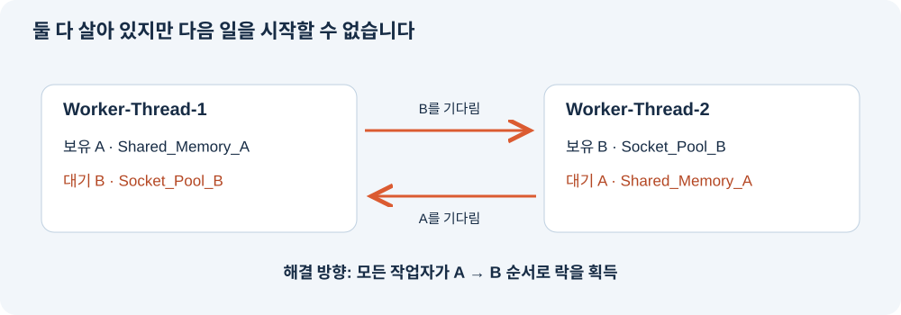

# 세 가지 서버 장애를 이해하고 설명하기

**설명의 핵심은 “무슨 일이 일어났고, 무엇을 보고 그렇게 판단했으며, 설정을 바꾸니 어떻게 달라졌는가”입니다.** 이번 실습에서는 메모리 누적에 따른 보호 종료, CPU 부하 정책에 따른 보호 종료, 서로의 자원을 기다리는 교착을 비교했습니다.

발표는 **세 장애의 차이 30초 → OOM 1분 → CPU 1분 → Deadlock 1분 → 진단 방법과 개선 1분** 순서로 진행하면 됩니다. 아래 인용문은 그대로 읽어도 되는 설명 예시입니다. 보너스 과제는 포함하지 않았습니다.

평가표의 질문에 하나씩 답하려면 [20개 문항별 설명과 답변](evaluation-answers.md)을 참고하세요. 화면으로 읽기 좋은 [브라우저용 답변 문서](evaluation-answers.html)도 함께 제공합니다.

## 1 세 장애를 한눈에 구별하기

프로그램을 **작업실**이라고 생각해 봅시다. 메모리는 물건을 올려놓는 작업대, CPU는 계산을 처리하는 능력, 스레드는 작업실 안에서 일하는 작업자, 락은 공동 도구를 사용할 때 필요한 열쇠입니다. PID는 작업실을 구별하는 번호입니다.

| 장애 | 작업실에 비유하면 | 이번 실습에서 보인 모습 | 판단의 핵심 |
|---|---|---|---|
| OOM | 작업대에 물건이 계속 쌓임 | 메모리가 증가한 뒤 앱이 스스로 강제 종료 | 증가 추세와 MemoryGuard 로그 |
| CPU | 작업 부하 경보가 울림 | 앱이 부하 초과를 기록하고 Watchdog로 종료 | 부하 로그와 종료 메시지 |
| Deadlock | 두 작업자가 서로의 열쇠를 기다림 | PID는 남아 있지만 일이 진행되지 않음 | 락 대기 관계와 진행 정체 |

먼저 **프로세스가 종료됐는지, 살아 있으면서 멈췄는지** 구별합니다. 종료됐다면 마지막 보호 정책 로그를 보고, 살아 있다면 작업이 실제로 진행되는지 확인합니다.

> “세 장애를 같은 ‘멈춤’으로 보지 않았습니다. OOM과 CPU 사례는 보호 정책에 의해 종료됐고, Deadlock은 프로세스가 살아 있는 상태에서 작업이 멈췄습니다.”

## 2 OOM은 물건이 계속 쌓이는 작업대

사용이 끝난 데이터를 계속 보관하면 메모리를 점점 더 차지합니다. 다른 프로그램이 사용할 공간까지 줄어들 수 있어, 이 앱의 **MemoryGuard가 설정된 한도에서 자신을 종료**했습니다. 이번에 확인한 것은 앱의 보호 동작입니다. 커널의 OOM killer가 종료했다고 판단한 것은 아닙니다.


**그림에서 볼 곳:** 주황색 선이 계속 높아집니다. 한도를 올린 실행이 더 오래 이어지지만, 증가 자체는 멈추지 않았습니다. 그래프의 RSS는 운영체제가 관측한 상주 메모리이므로 앱이 기록한 Heap와 숫자가 다를 수 있습니다.

| 비교 | 메모리 한도 | 관측 시간 | 결과 |
|---|---:|---:|---|
| 변경 전 | 50MB | 약 6.75초 | MemoryGuard 강제 종료 |
| 변경 후 | 200MB | 약 24.09초 | MemoryGuard 강제 종료 |

증거를 읽을 때는 아래 문구를 연결합니다.

```text
Current Heap: 200MB
Memory limit exceeded (200MB >= 200MB)
Self-terminating process 807
SELF-TERMINATED (Memory Limit Exceeded)
```

위 코드는 핵심 문구를 짧게 정리한 것입니다. PID·시각·전체 메시지는 [OOM 원본 로그 캡처](log-captures/oom-after.png)에서 확인할 수 있습니다.

**조치의 의미:** 작업대를 크게 만들면 가득 차는 시간이 늦어집니다. 물건을 계속 쌓는 원인은 남아 있습니다. 근본 개선은 불필요한 데이터 해제, 캐시·큐 크기 제한 등으로 보관량을 관리하는 것입니다. 정확히 어떤 객체가 누수를 만드는지는 소스나 메모리 프로파일링으로 추가 확인해야 합니다.

> “한도를 50에서 200MB로 올리니 관측 시간이 약 6.75초에서 24.09초로 늘었습니다. 하지만 같은 보호 정책으로 다시 종료됐습니다. 따라서 한도 상향은 시간을 벌어 주는 임시 조치라고 판단했습니다.”

## 3 CPU는 부하 경보와 실제 사용률을 함께 보기

여러 작업이 한정된 CPU를 경쟁하면 다른 요청이 기다리는 시간이 길어질 수 있습니다. **Watchdog는 정해진 조건을 감시하다가 보호 조치를 실행하는 감시자**입니다. 이 앱은 내부 부하가 기준을 위반했다고 기록한 뒤 `SIGTERM`, 즉 종료 요청 신호를 보냈습니다.


**그림에서 볼 곳:** 높은 설정의 주황색 선은 앱 부하 56.5%까지 올라간 뒤 끝납니다. 낮은 설정의 파란색 선은 부하 증가와 냉각을 반복하며 더 오래 이어집니다.

| 조치 관점의 비교 | CPU_MAX_OCCUPY | 관측 결과 |
|---|---:|---|
| 장애 조건 | 100 | 약 37.11초 관측 후 Watchdog 종료 확인 |
| 완화 조건 | 10 | 최소 약 76.12초 생존 후 실험 수집기가 종료 |

실험은 10 설정을 먼저 실행했으므로 원본 폴더의 `cpu-before`는 10, `cpu-after`는 100입니다. 위 표는 **장애 조건 → 완화 조건** 순서로 비교한 것입니다. 이 앱에서 완화 방향은 100 → 10이며, 설정값은 작업 부하 증가와 냉각 동작에도 관여했습니다.

```text
Current Load: 56.50%
CPU Threshold Violated! (56.5%)
WATCHDOG: INITIATING EMERGENCY ABORT (SIGTERM)
```

핵심 문구의 시각과 PID는 [CPU 원본 로그 캡처](log-captures/cpu-after.png)에 있습니다.

**반드시 구분할 점:** 위 그래프는 앱이 기록한 부하입니다. 100 설정에서 외부 관제로 측정한 CPU 최고치는 약 9.97%였습니다. 따라서 **“앱의 Watchdog 종료를 확인했다”**고 설명할 수 있지만, **“실제 OS CPU가 50%를 넘었다”**고 설명할 수는 없습니다. [외부 CPU 그래프](images/cpu.svg)와 함께 비교해야 합니다.

> “앱 부하 로그가 56.5%에 도달한 뒤 Watchdog 종료 메시지가 나왔습니다. 낮은 설정에서는 관측 창까지 생존했습니다. 다만 앱 부하와 실제 CPU 측정값이 달랐으므로, 저는 보호 정책의 재현과 실제 CPU 점유를 구분했습니다.”

## 4 Deadlock은 서로의 열쇠를 기다리는 두 작업자

작업자 1은 열쇠 A를 가지고 B를 기다리고, 작업자 2는 열쇠 B를 가지고 A를 기다립니다. 둘 다 가진 열쇠를 놓지 않으면 누구도 다음 일을 할 수 없습니다. 프로세스는 남아 있어도 작업은 진행되지 않습니다.



실제 로그에서 다음 순서를 확인했습니다.

| 순서 | Worker-Thread-1 | Worker-Thread-2 |
|---|---|---|
| 먼저 획득 | Shared_Memory_A | Socket_Pool_B |
| 추가로 요청 | Socket_Pool_B | Shared_Memory_A |
| 마지막 상태 | WAITING / BLOCKED | WAITING / BLOCKED |

PID **1059**는 살아 있었고, 마지막 10초 동안 RSS **18,244KiB**, 로그 크기 **2,717bytes**가 유지됐으며 구간 CPU는 **0%**였습니다. `ps -L`에서도 스레드들이 `futex_wait_queue`에서 대기했습니다. 이 상태만으로는 정상 유휴와 구분하기 어려우므로, **서로 반대로 락을 기다리는 로그**까지 연결했습니다. [데드락 원본 로그 캡처](log-captures/deadlock-before.png)

`MULTI_THREAD_ENABLE`만 true에서 false로 바꾸어 비교했습니다.

| 스레드 설정 | 결과 | 해석 |
|---|---|---|
| true | 락 순환 대기와 정체 | 교착 재현 |
| false | 작업 완료 후 자원 로그가 계속 진행 | 관측 구간에서 교착 회피 |

교착의 네 조건도 이 사례에 연결하면 쉽습니다. **상호 배제**는 한 열쇠를 한 사람만 갖는 것, **점유 대기**는 가진 열쇠를 놓지 않고 추가 열쇠를 기다리는 것, **비선점**은 다른 사람이 열쇠를 강제로 빼앗지 못하는 것, **순환 대기**는 서로 상대의 열쇠를 기다리는 것입니다.

근본 개선은 모든 작업자가 **A 다음 B라는 동일한 순서로 락을 획득**하도록 하는 것입니다. 그러면 B부터 잡고 A를 기다리는 반대 경로가 사라집니다. 단일 스레드 설정은 동시 경쟁을 줄이는 임시 회피책입니다.

> “PID가 살아 있다는 사실만으로 정상이라고 판단하지 않았습니다. 두 스레드의 락 소유와 대기 방향을 연결해 순환을 찾았고, 로그·CPU·메모리의 정체와 함께 확인했습니다. 단일 스레드에서는 작업이 계속 진행됐습니다.”

## 5 진단은 이 순서로 설명하기

**PID 확인 → 자원 추세 확인 → 마지막 로그 확인 → 설정 하나 변경 → 같은 지표로 비교** 순서로 설명하면 판단 근거가 명확해집니다.

| 알고 싶은 것 | 사용한 도구 | 이렇게 읽습니다 |
|---|---|---|
| 대상 프로세스가 존재하는가 | ps -p PID | 실제 작업 PID와 상태 확인 |
| 메모리가 계속 늘어나는가 | monitor.sh | /proc/PID/status의 VmRSS를 0.5초 간격으로 읽음 |
| 최근 구간에 CPU를 얼마나 썼는가 | monitor.sh | /proc/PID/stat의 CPU 시간 증가량을 실제 경과 시간으로 나눔 |
| 어느 스레드가 기다리는가 | ps -L, top -H | 스레드별 상태와 대기 지점 확인 |
| 왜 종료되거나 멈췄는가 | app.log | MemoryGuard, Watchdog, 락 대기 메시지 확인 |

`ps -p`의 `-p`는 PID 선택, `ps -L`의 `-L`과 `top -H`의 `-H`는 스레드 표시입니다. 저장할 때 사용한 `top -b -n 1`은 배치 모드로 한 번 출력하라는 뜻입니다. `ps -o`는 출력 열을 고릅니다. `ps %cpu`는 생애 평균이므로 순간 변화를 설명할 때는 구간 측정 CSV를 함께 봅니다.

메모리 추출을 구체적으로 설명하려면 **“status 파일을 콜론으로 나누고 VmRSS 행의 숫자를 읽었습니다. 단위는 KiB이고, 그래프에서는 1024로 나눠 MiB로 표시했습니다”**라고 말하면 됩니다. CPU는 **“이전 표본 이후 사용한 CPU 시간 ÷ 실제 경과 시간 × 100”**입니다. `/proc` 값의 시간 단위는 `CLK_TCK`로 초 단위로 바꿉니다.

이번 실행 파일은 부모가 기다리고 자식이 실제 작업을 수행했습니다. 그래서 자식 PID를 관측했습니다. 부모만 측정했다면 메모리 증가를 놓칠 수 있었습니다.

> “한 번의 숫자로 결론 내리지 않고 시간에 따른 변화를 봤습니다. 이어 마지막 로그로 원인을 연결하고, 환경변수를 하나만 바꿔 같은 지표로 다시 비교했습니다.”

## 6 평가 질문에 짧게 답하기

### 장애가 나기 전에 알아채려면

RSS 현재값뿐 아니라 **증가 속도와 한도까지 남은 시간**을 봅니다. 한도와 사용량이 같은 측정 기준일 때 남은 시간을 추정하고, 여러 표본에서 경고 조건이 지속될 때 알립니다. PID 확인에 작업 완료 수나 마지막 완료 시각을 더하면 교착도 빨리 알아챌 수 있습니다.

### 세 장애 중 무엇이 가장 위험한가

PID 존재만 감시하는 서비스라면 **Deadlock**을 고르겠습니다. 살아 있는 것으로 보여 자동 복구가 늦어질 수 있기 때문입니다. 다만 OOM이 서버 전체의 메모리를 고갈시키는 상황에서는 다른 서비스까지 영향을 받으므로 OOM 대응을 우선합니다.

### OOM과 Deadlock이 함께 발생하면

먼저 호스트 전체 메모리 고갈과 서비스 영향을 봅니다. 고갈이 임박하면 요청을 우회하거나 문제 인스턴스를 격리하고, 가능한 짧은 시간에 자원 추세와 락 대기 증거를 남긴 뒤 복구합니다. 메모리 여유가 충분하면 재시작 전에 교착 증거를 먼저 확보합니다.

### 코드를 고칠 수 있다면

| 장애 | 수정 방향 | 기대하는 효과 |
|---|---|---|
| OOM | 불필요한 데이터 해제, 캐시·큐 상한 설정 | 메모리 누적 제한 |
| CPU | 반복 계산·busy loop 제거, 작업량 제한 | 불필요한 CPU 사용 감소 |
| Deadlock | 락 획득 순서 통일, 중첩 락 축소 | 순환 대기 방지 |

### 처음부터 다시 한다면

실제 작업 PID와 시간대를 먼저 확인하고, 짧은 기준 실험으로 관제가 맞는지 점검하겠습니다. 그다음 한 번에 설정 하나만 바꾸고 조건별 반복 실행으로 결과가 일관적인지 확인하겠습니다. 마지막으로 임시 조치와 원인 제거를 구별해 보고하겠습니다.

## 증거를 더 확인할 때

실험은 **2026년 10월 20일**, 조건별 1회씩 수행했습니다. 약 75초 관측 창이 끝난 실행은 수집기가 종료했습니다. 따라서 “관측 구간에서 생존·진행”은 장기 무장애를 뜻하지 않습니다. 본문의 시간은 계측 주기와 실행기 확인 지연을 포함한 관측 시간입니다.

[OOM 상세 보고서](../reports/01-oom.md) · [CPU 상세 보고서](../reports/02-cpu.md) · [Deadlock 상세 보고서](../reports/03-deadlock.md) · [전체 실측 비교표](../reports/comparison.md) · [README](../README.md)
