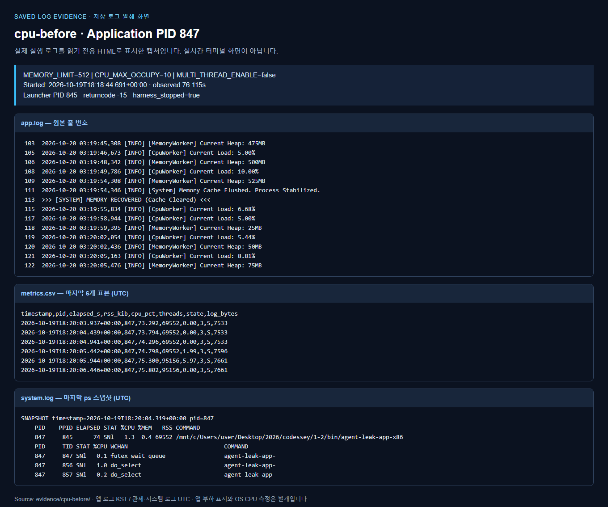
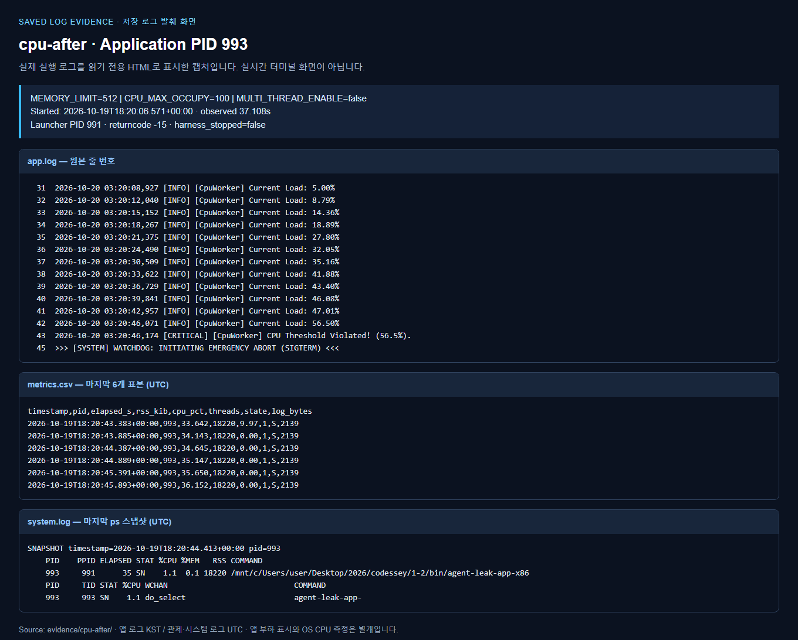

# [Bug] CPU - 작업 부하 설정 변화와 Watchdog 보호 종료 비교

## 1. Description (현상 설명)

CPU_MAX_OCCUPY=10%와 100%를 비교했다. 실행 ID cpu-before는 10%, cpu-after는 100%인 실험 순서를 뜻한다. 개선 조치는 높은 설정에서 낮은 설정으로 되돌리는 방향이며, Before/After 이름만으로 성공 여부를 판단하지 않는다.

## 2. Evidence & Logs (증거 자료)

| 실행 ID | 앱 PID | 관측 초 | 최대 RSS MiB | 최대 구간 CPU % | 결과 |
|---|---:|---:|---:|---:|---|
| cpu-before | 847 | 76.115 | 518.0 | 13.94 | 관측 창 종료까지 PID 생존 (수집기가 정리) |
| cpu-after | 993 | 37.108 | 17.8 | 9.97 | Watchdog SIGTERM 종료 |

### cpu-before (앱 PID 847, 실행기 PID 845)



- 시작 UTC: `2026-10-19T18:18:44.691+00:00`
- 종료/관측 종료 UTC: `2026-10-19T18:20:06.508+00:00`
- 관측 시간: **76.115초**
- 판정: **관측 창 종료까지 PID 생존 (수집기가 정리)** / returncode `-15` / 수집기 종료 `True`
- [실행 로그](../evidence/cpu-before/app.log), [관제 CSV](../evidence/cpu-before/metrics.csv), [ps·top 출력](../evidence/cpu-before/system.log), [설정 및 결과](../evidence/cpu-before/result.json)

```text
2026-10-20 03:18:47,886 [INFO] [CpuWorker] Started. Maximum CPU Limit: 10%
2026-10-20 03:18:47,889 [INFO] [CpuWorker] Current Load: 5.00%
2026-10-20 03:18:49,994 [INFO] [CpuWorker] Peak reached (10.00%). Starting cooldown...
2026-10-20 03:18:51,000 [INFO] [CpuWorker] Current Load: 10.00%
2026-10-20 03:18:54,109 [INFO] [CpuWorker] Current Load: 5.50%
2026-10-20 03:18:57,223 [INFO] [CpuWorker] Current Load: 5.29%
... (중간 생략: 원본 app.log 참조) ...
2026-10-20 03:19:30,100 [INFO] [CpuWorker] Cooldown complete (5.00%). Resuming load increase...
2026-10-20 03:19:31,103 [INFO] [CpuWorker] Current Load: 5.00%
2026-10-20 03:19:33,213 [INFO] [CpuWorker] Peak reached (10.00%). Starting cooldown...
2026-10-20 03:19:34,219 [INFO] [CpuWorker] Current Load: 10.00%
2026-10-20 03:19:36,322 [INFO] [CpuWorker] Cooldown complete (5.00%). Resuming load increase...
2026-10-20 03:19:37,328 [INFO] [CpuWorker] Current Load: 5.00%
2026-10-20 03:19:40,439 [INFO] [CpuWorker] Current Load: 8.39%
2026-10-20 03:19:42,550 [INFO] [CpuWorker] Peak reached (10.00%). Starting cooldown...
2026-10-20 03:19:43,557 [INFO] [CpuWorker] Current Load: 10.00%
2026-10-20 03:19:45,667 [INFO] [CpuWorker] Cooldown complete (5.00%). Resuming load increase...
2026-10-20 03:19:46,673 [INFO] [CpuWorker] Current Load: 5.00%
2026-10-20 03:19:48,779 [INFO] [CpuWorker] Peak reached (10.00%). Starting cooldown...
2026-10-20 03:19:49,786 [INFO] [CpuWorker] Current Load: 10.00%
2026-10-20 03:19:55,834 [INFO] [CpuWorker] Current Load: 6.68%
2026-10-20 03:19:57,939 [INFO] [CpuWorker] Cooldown complete (5.00%). Resuming load increase...
2026-10-20 03:19:58,944 [INFO] [CpuWorker] Current Load: 5.00%
2026-10-20 03:20:02,054 [INFO] [CpuWorker] Current Load: 5.44%
2026-10-20 03:20:05,163 [INFO] [CpuWorker] Current Load: 8.81%
```
### cpu-after (앱 PID 993, 실행기 PID 991)



- 시작 UTC: `2026-10-19T18:20:06.571+00:00`
- 종료/관측 종료 UTC: `2026-10-19T18:20:46.582+00:00`
- 관측 시간: **37.108초**
- 판정: **Watchdog SIGTERM 종료** / returncode `-15` / 수집기 종료 `False`
- [실행 로그](../evidence/cpu-after/app.log), [관제 CSV](../evidence/cpu-after/metrics.csv), [ps·top 출력](../evidence/cpu-after/system.log), [설정 및 결과](../evidence/cpu-after/result.json)

```text
2026-10-20 03:20:08,926 [INFO] [CpuWorker] Started. Maximum CPU Limit: 100%
2026-10-20 03:20:08,927 [INFO] [CpuWorker] Current Load: 5.00%
2026-10-20 03:20:12,040 [INFO] [CpuWorker] Current Load: 8.79%
2026-10-20 03:20:15,152 [INFO] [CpuWorker] Current Load: 14.36%
2026-10-20 03:20:18,267 [INFO] [CpuWorker] Current Load: 18.89%
2026-10-20 03:20:21,375 [INFO] [CpuWorker] Current Load: 27.80%
2026-10-20 03:20:24,490 [INFO] [CpuWorker] Current Load: 32.05%
2026-10-20 03:20:30,509 [INFO] [CpuWorker] Current Load: 35.16%
2026-10-20 03:20:33,622 [INFO] [CpuWorker] Current Load: 41.88%
2026-10-20 03:20:36,729 [INFO] [CpuWorker] Current Load: 43.40%
2026-10-20 03:20:39,841 [INFO] [CpuWorker] Current Load: 46.08%
2026-10-20 03:20:42,957 [INFO] [CpuWorker] Current Load: 47.01%
2026-10-20 03:20:46,071 [INFO] [CpuWorker] Current Load: 56.50%
2026-10-20 03:20:46,174 [CRITICAL] [CpuWorker] CPU Threshold Violated! (56.5%).
>>> [SYSTEM] WATCHDOG: INITIATING EMERGENCY ABORT (SIGTERM) <<<
```

## 3. Root Cause Analysis (원인 분석)

CpuWorker 로그의 Current Load와 외부 관제 CPU는 측정 방식이 다르다. 이 바이너리에서는 설정값이 Maximum CPU Limit와 부하 증가·cooldown 동작에 관여하는 것이 관측된다. 보호 종료 여부는 WATCHDOG와 SIGTERM 메시지를 근거로 판단한다. 종료 코드 -15만으로 Watchdog를 확정하면 수집기의 SIGTERM을 혼동할 수 있다.

## 4. Workaround & Verification (조치 및 검증)

임시 조치는 CPU_MAX_OCCUPY를 100 → 10으로 낮추는 것이다. 아래 두 실행으로 종료 여부와 생존 시간을 비교한다. MEMORY_LIMIT=512, MULTI_THREAD_ENABLE=false는 고정했다. 구간 CPU 표본의 최고치는 짧은 순간 급등을 놓칠 수 있으며 내부 정책 임계치의 정확한 식은 역분석하지 않았다.

측정은 조건당 1회이며, 75초 관측 창 종료 시에는 수집기가 시작한 프로세스 그룹에 SIGTERM을 보낸다. `harness_stopped=true`는 앱 자체 종료 증거로 사용하지 않는다. 원본 로그의 종료 문구를 우선한다.

### 조치 관점의 Before & After

| 구분 | 설정 | 실행 ID | 관측 결과 |
|---|---|---|---|
| 조치 전 장애 조건 | CPU_MAX_OCCUPY=100 | cpu-after | 37.108초 관측 후 Watchdog 종료 확인 |
| 조치 후 완화 조건 | CPU_MAX_OCCUPY=10 | cpu-before | 최소 76.115초 생존, 관측 창 종료 후 수집기가 정리 |

실험은 낮은 설정을 먼저 실행했다. 위 표는 실제 수행 시점을 바꾸지 않고, 장애 조건과 완화 조건을 조치 관점에서 배치한 것이다.

**검증 결론:** 100% 설정에서는 앱 부하가 50%를 넘은 뒤 CPU Threshold Violated 및 WATCHDOG SIGTERM 로그로 종료했다. 10% 설정에서는 부하 증가·cooldown 로그가 이어졌고 관측 창까지 생존했다. 따라서 완화 방향은 100 → 10%다. 외부 관제 CPU는 앱이 보고한 부하와 같은 비율로 상승하지 않았으므로, 이 자료가 실제 OS CPU 50% 초과를 입증한다고 주장하지 않는다.

외부 구간 CPU 최대 관측값은 10% 설정에서 13.94%, 100% 설정에서 9.97%였다. 따라서 실제 OS CPU 과점유 재현이라는 평가 요소에는 이 한계를 함께 제시해야 한다. 원본을 변경하거나 별도 부하를 만들어 제공 앱의 사용률로 제시하지 않았다.
